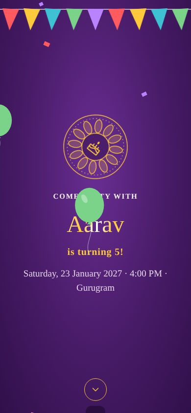

# 🪔 shubh-invite

**Beautiful, animated invitation websites for Indian occasions. No coding needed.**

Edit one file, drop your photos into a folder, and your invitation is online with a link you can share on WhatsApp.

<p align="center">
  
  
  
  
</p>

## ✨ What you get

- **11 invitation types:** Wedding, Engagement (Sagai), Reception, Anniversary, Birthday, Griha Pravesh, Godh Bharai, Naamkaran, Mundan, Puja / Katha, and Party
- **Works with or without photos.** Add photos and they appear automatically. Without photos you get a decorated design.
- **Animations:** falling marigold petals, a swaying toran, ringing temple bells, flickering diyas, a rotating mandala, confetti, balloons, hearts and sparkles
- **Opening doors.** Guests tap "Open Invitation" and the doors swing open.
- **Personal greeting.** Send `…/?to=Gupta Family` and the guest sees *"Dear Gupta Family,"*
- **Live countdown** to the big day
- **Event schedule** (Haldi, Mehendi, Sangeet…) with icons
- **Photo gallery** with a full-screen viewer that you can swipe on phones
- **Venue** with a Google Maps "Get directions" button
- **Add to calendar** (Google Calendar or the phone's calendar)
- **RSVP on WhatsApp.** Replies come straight to your WhatsApp. No server is needed.
- **Background music** (optional)
- Works on phones and computers, supports Hindi text, and is free to host on GitHub Pages

---

## 🚀 Make your invitation in 5 steps

### 1. Get your own copy
Click the green **Use this template** button, then **Create a new repository**. Give it a name, e.g. `sharma-wedding`.

> No button? Click **Fork** instead, or use **Code → Download ZIP** to work on your computer.

### 2. Fill in your details
Open **`config.js`** and click the ✏️ pencil icon. Change the text inside the "quotes": names, date, events, venue and your WhatsApp number. Then click **Commit changes**.

```js
type: "wedding",                 // wedding, birthday, housewarming, babyshower …
names: ["Ananya", "Arjun"],      // one or two names
date: "2027-02-14T19:30",        // YYYY-MM-DDTHH:MM (24-hour)
place: "Jaipur",
```

> ⚠️ Keep the quotes `" "` and the commas `,` at the end of lines. If the page shows **"Almost there!"**, a comma or quote is missing. The message tells you which line to check.

### 3. Add photos (optional)
Open the **`photos`** folder, then **Add file → Upload files**:

| File name | Where it shows |
|---|---|
| `photos/cover.jpg` | Main photo at the top, in a gold arch frame |
| `photos/gallery/1.jpg`, `2.jpg`, `3.jpg` … | Photo gallery |

- Number the gallery photos **1, 2, 3 … with no gaps**. The page stops looking when a number is missing.
- `.jpg`, `.jpeg`, `.png` and `.webp` all work.
- **No photos?** Skip this step. The page shows a decorated design instead.
- Keep each photo under ~500 KB so the page loads fast. You can shrink photos for free at [squoosh.app](https://squoosh.app).

### 4. Add music (optional)
Upload an MP3 as **`music/song.mp3`**. Phones only play music after a tap, so it starts when the guest taps **Open Invitation**. A 🔊 button lets guests turn it off.

### 5. Put it online (free)
Go to **Settings → Pages**. Under *Build and deployment*, choose **Deploy from a branch**, then pick **`main`** and **`/ (root)`** and click **Save**.

After 1–2 minutes your invitation is live at:

```
https://YOUR-USERNAME.github.io/YOUR-REPO-NAME/
```

Every time you change `config.js` or add photos, the site updates by itself within a minute or two.

---

## 💌 Sharing tips

- **Personal links:** add `?to=` and the guest's name. Use `%20` for spaces:
  `https://you.github.io/sharma-wedding/?to=Gupta%20Family` shows *Dear Gupta Family,*
- **Nice WhatsApp preview:** in `index.html`, edit the `og:title`, `og:description` and `og:image` lines near the top. `og:image` must be a full link, e.g. `https://you.github.io/sharma-wedding/photos/cover.jpg`.
- **Privacy:** on a free GitHub account, Pages sites are public. Anyone with the link can see the page. Don't put home addresses or phone numbers there if you're not comfortable sharing them.

---

## 🎨 Invitation types

Set `type` in `config.js`. Each type sets its colours, animations, decorations and default heading. You can still change any of them.

| `type` | Default heading | Look & animations |
|---|---|---|
| `wedding` | Shubh Vivah | Maroon & gold · petals, toran, bells, diyas, mandala |
| `engagement` | Engagement Ceremony | Rose & gold · petals, hearts |
| `reception` | Wedding Reception | Royal blue & gold · sparkles |
| `anniversary` | Anniversary Celebration | Royal blue · hearts, sparkles |
| `birthday` | Birthday Party | Purple · confetti, balloons, bunting |
| `housewarming` | Griha Pravesh | Emerald & gold · petals, toran, diyas |
| `babyshower` | Godh Bharai | Blush pink · bubbles, hearts, bunting |
| `naming` | Naamkaran Ceremony | Sky blue · sparkles, bubbles |
| `mundan` | Mundan Sanskar | Saffron · petals, toran, diyas |
| `puja` | Puja & Prasad | Saffron · petals, sparkles, diyas, mandala |
| `party` | Celebration | Black & gold · sparkles, confetti |

**Preview any type:** open your site with `?example=` and a type name, e.g. `…/?example=birthday` or `…/?example=housewarming`. The sample files are in the [`examples`](examples) folder. Copy one into `config.js` to start from it.

### Change colours
Set `palette` to one of: `maroon`, `rose`, `royal`, `emerald`, `saffron`, `blush`, `sky`, `party` or `night`.

### Change the animations
```js
effects: ["petals", "sparkles"],   // petals confetti balloons hearts sparkles bubbles  ([] = none)
decor:   ["toran", "diyas"],       // toran bunting bells mandala diyas
style:   "playful",                // "elegant" (calligraphy) or "playful" (round & fun)
gate:    false,                    // skip the opening doors
```

Guests whose phones are set to *Reduce motion* automatically see a version without animations.

---

## 🧪 Try it on your computer

Download the ZIP, unzip it, and **double-click `index.html`**. It opens in your browser. Nothing to install.

## 📁 What's inside

```
index.html          ← the page (edit only the preview tags at the top)
config.js           ← ✏️ YOUR DETAILS — edit this
photos/cover.jpg    ← optional main photo
photos/gallery/     ← optional 1.jpg, 2.jpg, 3.jpg …
music/song.mp3      ← optional background music
examples/           ← sample settings for every type
assets/             ← design & code (no need to touch)
```

## ❓ Problems?

| Problem | Fix |
|---|---|
| Page says **"Almost there!"** | A comma or quote is missing in `config.js`. Check the line you changed last. |
| Photos don't show | Check the names: `cover.jpg` and `gallery/1.jpg`. GitHub treats `Cover.JPG` and `cover.jpg` as different names. Number gallery photos with no gaps. |
| Link shows 404 | Wait 2 minutes after turning on Pages, and check that **Settings → Pages** says *Your site is live*. |
| Countdown is missing | The date must be in the future and in the format `"2027-02-14T19:30"`. |
| RSVP form is missing | Add your WhatsApp number in `rsvp.whatsapp` (country code, digits only, e.g. `"919876543210"`). |

---

Made with ❤️ for Indian celebrations. Free to use under the [MIT License](LICENSE). Fonts from Google Fonts (Open Font License).
